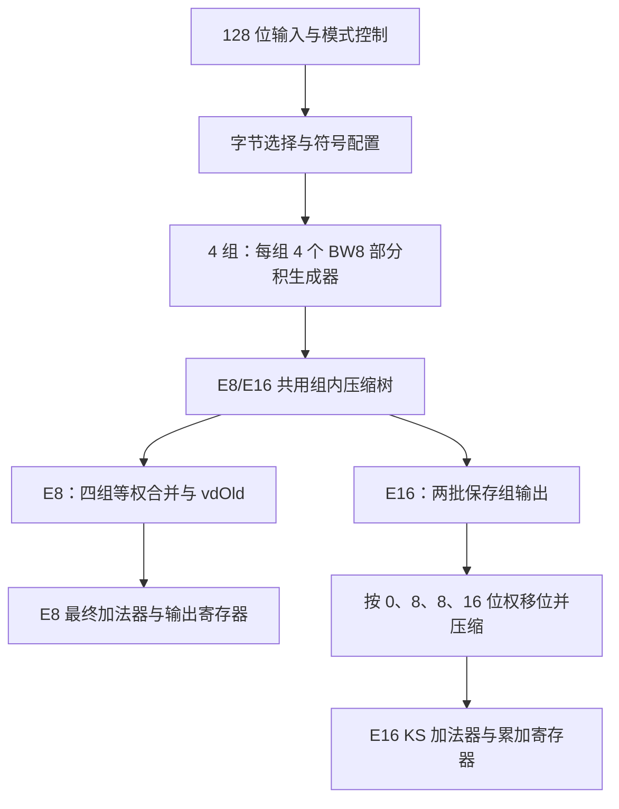

# BWFast：24 配置单批 Chisel 实验

> **2026-11-06 归档补记**：下文「本环境没有 sbt、Verilator、Yosys」的结论已不适用——K07 已完成 Scala 编译、模块级仿真（20 seeds）、Yosys 综合与 ASAP7 STA。交付版双模式 K07 的时序与面积见 `docs/stage3/3.7-K07双模式时序修正.md`。原文保留作历史记录。

本包是可运行的独立模块工程，尚未接入你的私有香山源仓库。所有候选共用接口、控制器和测试平台；配置在 elaboration 时静态选择，硬件中不存在 24 路版本选择器。本轮不新增 E32 乘法器。

## 已完成与待验证

已完成：24 个配置的 Chisel 源码、独立整数 scoreboard、批处理入口、计数器形式证明入口和算术模型检查。交付时算术模型结果见 `model_results.json`：24×96=2304 个 E8/E16 四符号模式用例通过；7 输入计数器穷举 128 项、15 输入穷举 32768 项、31 输入随机 3000 项通过。

**本环境没有 sbt、Verilator、Yosys，尚未完成 Scala 编译、RTL 仿真、形式证明或综合。Python 模型通过不等于 RTL 正确，也不是时序测量。** 首次 WSL 运行可能暴露编译器或工具兼容性问题，请保留完整日志。本包不宣称任一候选已经提速或达到香山目标频率。

## 结构与边界



E8：16 对 8 位元素点积，正常无停顿时延迟 1 拍、启动间隔 1 拍。E16：8 对 16 位元素点积，每批 4 对、共两批，延迟 4 拍；不增加乘法器。组顺序为 LL、HL、LH、HH；低字节永远按无符号解释，高字节继承各自操作数的符号模式。每组用 carry-save 两行（Q3 三行）表示，而不是先形成一个二进制组和，避免四次串行进位。E16 的四组权重在组外处理，组内树与 E8 共享。

`FastRequest`：`vs1/vs2` 各 128 位、`vdOld` 32 位、`a_signed/b_signed`、`sew` 2 位、`mask` 16 位、`tag` 8 位。
`FastResponse`：`result` 32 位、`tag` 8 位。顶层为 `in/out` Decoupled 和 `flush`，保持上一版 BWFastTop 接口。**它不是已经接好的香山 vd/vxsat 接口**；该独立实验模块没有 vxsat，也不实现饱和。结果为模 2^32 的 `vdOld + sum(a*b)`。E8 使用 mask[15:0]；E16 使用 mask[7:0]。sew=0 为 E8，1 为 E16，2/3 返回 vdOld。flush 取消待输出和进行中的 E16；背压期间结果保持。

“一拍”描述寄存器间隔，不是物理频率保证。完整 E8 路径还包括输入/状态选择、符号与 mask 逻辑、组压缩、合并、最终加法器、结果选择和寄存器建立时间。

## 实际实现清单

| 配置 | 相对 B 的改动 |
|---|---|
| B | V2 并行尾层，FA 递归 7:3/15:4，KS 最终加法器 |
| S01 | E8 4 位等长 CSLA/BEC，增量器包括进位位 |
| S02 | 7:3 精确混合候选：FA / 前缀 / 平衡奇偶 / 排序阈值按输出择优 |
| S03 | 15:4 同类候选 |
| S04 | 按到达深度排序、两计数器前瞻调度 |
| S05 | 仅 3:2 的并行分层树 |
| S06 | 合并 BW 高位符号补偿常量，保留逐元素 mask |
| S07 | 字节路由改为三来源 one-hot 与或逻辑 |
| S08 | 末端三行 parity/majority 直接接 KS |
| Q1 | E8 非等长 CSLA/BEC，分块 2/3/4/5/6/6/6 |
| Q2 | 允许精确 31:5 混合候选 |
| Q3 | 组内保留三行，推迟末端压缩 |
| K01 | S02 S03 |
| K02 | S02 S03 S01 |
| K03 | S02 S03 S04 |
| K04 | S02 S03 S01 S04 |
| K05 | S02 S03 S01 S04 S06 S07 |
| K06 | S02 S03 Q1 S04 S06 S07 |
| K07 | S02 S03 S04 S06 S07 |
| K08 | S02 S03 S04 S06 S07 S08 |
| K09 | K08 + Q2 |
| K10 | K08 + Q3 |
| K11 | K08 + Q2 Q3 |
| K12 | S05 S01 S06 S07 |

需要明确的实现范围：S02/S03/Q2 是自行推导的精确结构，**不是某篇论文低延迟方程的逐式复现**。S04 是有界两计数器前瞻，不是完整 beam search；调度使用保守 FA 深度。`Bit.t` 的单位是抽象门级深度，不是 ps 或 FO4。生成器会构造备选表达式，但只将选中输出接入数据通路，未使用逻辑由后端优化移除。

这些候选是值得测量的假设，不保证全部优于 B。S08 可能被综合成与常规尾层相同的逻辑；runner 记录完全相同 RTL 的别名，其他等价/同构网表仍需检查，不能把配置数当成独立硬件结构数。不要用此前 48 版结果给本轮配置填入性能数值。

## WSL 一次运行全部版本

使用 WSL Ubuntu 22.04 中已有工具：JDK（建议与已验证 Chisel 环境一致）、sbt 1.10.7、Scala 2.13.17、Chisel 7.2.0、Verilator、Yosys、make、g++、Python 3。首次编译需要相应 Maven 缓存或网络；本包不自动安装工具。保持所有候选相同版本。

解压后进入 `bw_batch24` 目录运行：

```bash
export OSS_ROOT="$HOME/toolchain/oss-cad-suite"
export SBT_JAR="$HOME/toolchain/sbt-launch.jar"
SEEDS=20 JOBS=8 bash run_batch_wsl.sh
```

如果 sbt 已在 PATH 且没有 launcher JAR，可以不设置 SBT_JAR。JOBS 是 Verilator 构建并行度，候选按冻结清单顺序执行。SEEDS 默认 20，不改变即可统一比较。

流程：工具检查 → Python 算术模型 → Scala compile → 7/15/31 计数器 Yosys SAT → 逐配置生成 RTL → 资源数量检查 → Verilator 20 seeds → 同条件 Yosys 综合与逻辑深度 → 打包。计数器证明检查所有可选输出表达式，不仅检查等到达时间下选择的表达式。SAT 超时算未通过，不能当作等价。

某版失败继续测试其他版本；公共编译失败则所有版本标记 BLOCKED_BUILD。缺少工具会在入口退出。脚本每次重新构建候选目录，**当前不支持断点续跑**；重新运行前先复制旧的 `batch_results`，防止覆盖。本轮只执行一次全批，不自动追加搜索或选择新组合。

单独定位编译问题可运行：

```bash
java -jar "$SBT_JAR" compile
java -jar "$SBT_JAR" 'runMain vdot.EmitBatch B generated/B'
```

## 测量、筛选与回传

`batch_results/summary.csv` / `.json`：正确性状态、检查次数、组合单元数、寄存器位数、通用门网表最长路径深度、RTL SHA256、完全相同 RTL 的别名、错误原因。各版目录保留配置、elaboration 树日志、全部 seed 日志、RTL、综合脚本和日志、stat、ltp、网表。顶层资源检查确认只生成一个 frontend，其 elaboration 内有 4×4 BW8；这不是标准单元面积审计。

先排除 RTL/形式证明失败的候选。再比较单项相对 B 的增量及组合相对父组合的增量。组合单元数仅是统一通用门集下的面积代理；ltp -noff 给出整模块最长组合路径层数，可能落在 E16 或控制逻辑，不能直接称为 E8 延迟。请保留 ltp 路径端点，以判断瓶颈是否转移。

有标准单元 Liberty 时可使用已有综合/STA 流程。设置 `STA_DRIVER` 为自己的脚本绝对路径、`LIBERTY` 和 `TARGET_PERIOD_NS`。驱动按 `bash "$STA_DRIVER" 每版结果目录` 调用，必须从该版 `generated` RTL 重新映射，写入 `sta_results.json` 并保存原始报告、约束、工具版本和库校验值。应分别报告 E8 寄存器路径、E16 路径及全模块最差路径，给出 delay/WNS/TNS/面积；统一 PVT、clock uncertainty、I/O delay、负载和驱动能力。不要将通用 ABC 网表直接冒充已映射库网表。

本包只提供 STA 对接入口，**不包含针对你工艺库的 STA 驱动**。驱动完成不等于时序满足，报告仍需检查。若只有通用门综合，报告应写“逻辑深度相对比较”，不要换算 GHz。与香山比较需使用同库同约束下的参考流水段，或将候选接入整核后检查对应寄存器边界。独立模块仿真不能替代 NEMU/Difftest 整核测试。

运行结束后回传 `BWFast_BATCH_RESULTS.zip`，不要只发截图。它包含源码、测试脚本、版本与失败日志、24 配置结果和网表，省去仿真构建缓存。若缺工具导致未生成 ZIP，请回传终端报错和工具路径。交付包自带的 `model_results.json` 仅代表本次 Python 模型检查，不能替代你运行产生的 RTL 结果。

补充模型检查：`scripts/check_edges.py` 已通过 128 项路由选择、8 项三输入 parity/majority 恒等式，以及 KS/两种 CSLA 各 10003 对边界与随机输入。结果见 `edge_results.json`；这些仍是模型检查。
